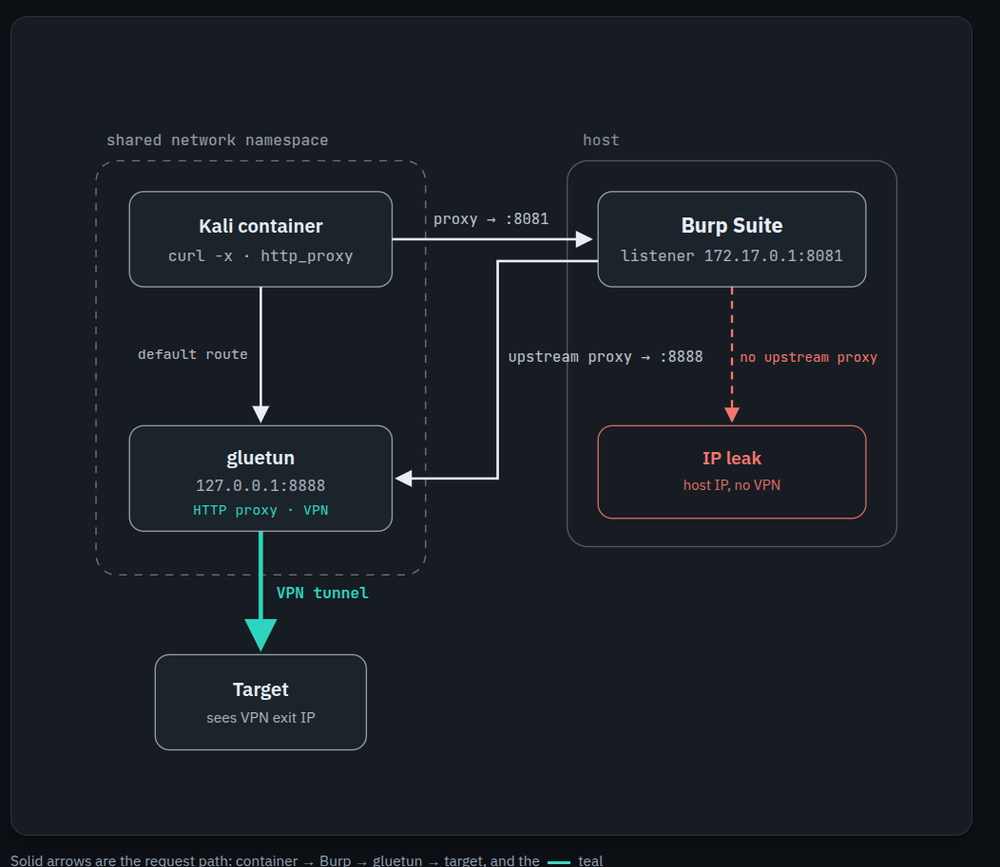
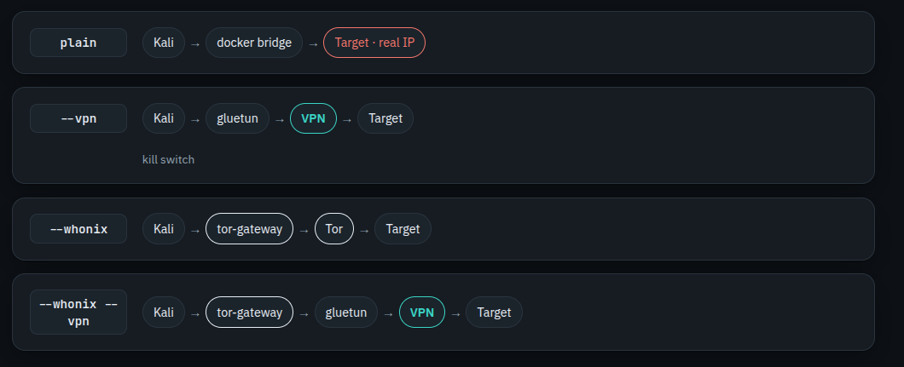
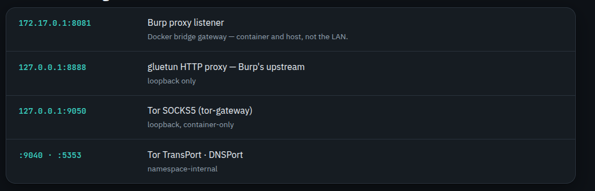

# pomdock

Local Kali workspaces for pentesting and red teaming, using Docker containers or
libvirt VMs. Each engagement keeps its loot, Atuin history, terminal recordings and
Tracker edits together. Choose direct networking, VPN, Tor or Tor over VPN.

> This repository is heavily tuned to my own workflow. I mainly use the Docker part for
> engagements. The VM side works but is not used that often and sees less love. The Docker
> part also works on macOS, though I don't use it there myself.



## Install

```bash
cd cli && make build
make install            # PREFIX sets the location
make completion-zsh
```

Needs Go, Node 22.18+ (build only), and Docker. Host tmux is used for VM terminals and jobs; container tmux is bundled in the image. Recorded-output search and replay
also require Python 3.11+ on the host; its processing modules are bundled locally. VMs also need libvirt and QEMU.
See [docs/vms.md](docs/vms.md) for the list.

## Use

```bash
pomdock doctor                                  # check this local installation
pomdock docker start acme --vpn ~/vpn/client.conf # start Kali
pomdock docker start tor-lab --route tor            # start in the background
pomdock docker attach acme                       # create or resume its tmux workspace
pomdock docker status acme                       # runtime and sidecar states
pomdock web                                     # Tracker, recordings and terminals
pomdock sessions search 'open' acme              # commands and output
pomdock sessions show acme                       # timeline and terminal replay
pomdock tui                                     # terminal UI
```

Named containers keep loot in `~/pomdock/workspaces/NAME` unless configured otherwise. `exec`
creates or restarts the container when needed; `start` leaves it in the background.
`attach` reconnects to persistent panes; `exec` opens a separate recorded shell without tmux.
Use `--route direct|vpn|tor|tor-vpn` to choose routing. Stop a running container before
changing its route; stopped containers are recreated with their loot preserved.

Docker actions accept `NAME` or `--name NAME`. `docker rm NAME` removes the container
and sidecars while keeping loot; `--purge` explicitly requests loot deletion.
`docker logs NAME` shows container and sidecar logs; `sessions logs NAME` lists recorded shells.
`docker build --toolset minimal` builds the shell/recording toolset; the default is
`full`. Add `--fresh` to rebuild without cached layers.

Run `pomdock COMMAND --help` for flags. VM commands remain under `pomdock vm`;
for example, `pomdock vm create kali` and `pomdock vm ssh kali`.

## Network modes





## Docs

- [Docker](docs/docker.md)
- [VMs](docs/vms.md)
- [Sessions & reporting](docs/sessions.md)
- [TUI](docs/tui.md)
- [Testing](docs/testing.md)
